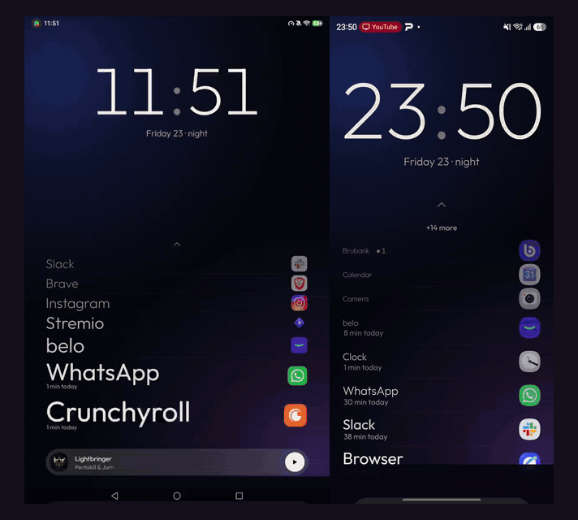

# Fran Launcher

An ultralight Android launcher for tablets and phones: a big clock, your favorite apps ordered by how much you use them, and nothing else. No data collection, no ads, no accounts, no internet permission.

Made by [Pakvothe](https://github.com/Pakvothe). Sibling of [Fran Launcher TV](https://github.com/Pakvothe/fran-launcher-tv).



[Español](README.es.md) · **[Download the APK](https://github.com/Pakvothe/fran-launcher/releases/latest)** (121 KB, Android 10+)

## Why

Stock launchers keep hundreds of megabytes in memory to show widgets, feeds and suggestions you didn't ask for. Fran Launcher does less on purpose: everything is drawn locally, in a single native View, and it does zero work while you're not touching it.

Measured on two devices against Niagara Launcher and the stock launcher (private RAM = Java + native + code; RAM 20 s after launch; cold start = median of 3):

**Honor Pad (NDL-W09, Android 16, 1200×1920)**

| | Fran Launcher | Niagara | Honor (stock) |
|---|---|---|---|
| Private RAM | **12.2 MB** | 50.1 MB | 201.7 MB |
| Total RAM (PSS) | **56.6 MB** | 110.8 MB | 263.9 MB |
| Cold start | **425 ms** | 638 ms | n/a (relaunches itself) |
| Idle CPU | ~0% | ~0% | ~0% |

**Samsung Galaxy S24 Ultra (Android 17, 1440×3120)**

| | Fran Launcher | Niagara | One UI (stock) |
|---|---|---|---|
| Private RAM | **28.1 MB** | 54.5 MB | 363.7 MB |
| Total RAM (PSS) | **142.8 MB** | 189.9 MB | 481.9 MB |
| Cold start | 92 ms | 113 ms | 54 ms (kept preloaded) |
| Idle CPU | ~0% | ~0% | ~0% |

Most of the total RAM is the window's graphic buffers, which depend on the screen resolution, not on the launcher.

## Features

- **Big clock** centered, with the date and the time of day. Tap the time for alarms, the date for the calendar.
- **Favorites by usage**: the app you use most sits at the bottom, next to your thumb, with a bigger name; less-used ones get smaller going up. Shows today's screen time ("38 min today") and a notification count. Reordering has hysteresis, so the list doesn't jump around.
- **Show more**: if your favorites don't fit, a "+N more" opens a scrollable list.
- **App drawer**: swipe up. Search, A-Z list with letter index and a big letter while you scrub. Long-press any app: add/remove from home, hide, info, uninstall.
- **Backgrounds**: soft orbs that follow the time of day (default), your system wallpaper, white, or black.
- **Now playing**: title, artist and artwork, with play/pause. Optional; needs notification access, only used to read the media session and count notifications.
- **Rest mode**: after a few idle seconds the clock grows and centers. Configurable or off.
- **Responsive**: tablets in portrait and landscape (rotation can be locked), phones always in portrait.
- **Languages**: English and Spanish.

## How it's built

- **Plain Java**, `minSdk 29`, no Kotlin, no AndroidX, zero third-party dependencies.
- **One Activity, one View, a tree of `RenderNode`s**: no XML layouts, no `RecyclerView`, no `Fragment`. Scrolling and pressing are just properties on already-recorded nodes.
- **Zero idle work**: no polling, no animations at rest. The clock redraws once a minute.
- **Boots from a binary snapshot**: config, app list and the icon atlas are read raw (`FileChannel.map`), no image decoding. Apps are only re-scanned when something is installed, removed or updated.
- **Search without an `EditText`**: the View talks to the keyboard through its own `InputConnection`.
- **JVM-testable logic**: usage ranking and the snapshot format live in the `core` module with no Android APIs.

```
launcher/
  app/   Android app (HomeActivity, Stage, scene layers, data, media)
  core/  Plain Java logic + JUnit tests
```

## Install and set as Home

Grab the APK from [Releases](https://github.com/Pakvothe/fran-launcher/releases/latest) (or build it), install it, press Home and choose Fran Launcher. Or over adb:

```sh
adb install -r fran-launcher.apk
adb shell cmd package compile -m speed -f pakvothe.franlauncher.tablet
```

Optional permissions, from Settings inside the launcher (long-press an empty area of the home screen):

- **Sort by usage** → Usage access.
- **Now playing and notifications** → Notification access.

## Build

```sh
cd launcher
./gradlew :core:test :app:assembleRelease
```

## License

MIT. The Outfit font is under the SIL Open Font License.
